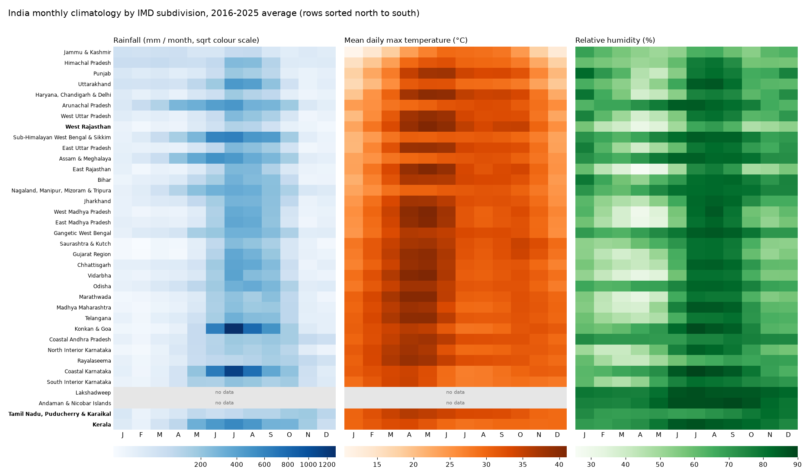

# India monthly climate by IMD subdivision

A 10-year monthly dataset of **rainfall, temperature and relative humidity for India's 36
IMD meteorological subdivisions** (January 2016 to December 2025), built only from public,
observation-based sources. It is meant as a weather "events" table for projects such as
studying how weather relates to petrol and diesel sales.

The data file is [`data/processed/climate_monthly.csv`](data/processed/climate_monthly.csv):
4,320 rows (36 subdivisions x 120 months). Every column is defined in
[`DATA_DESCRIPTION.md`](DATA_DESCRIPTION.md), which also lists the limitations. **Read the
limitations before using the data.**

| Column | Meaning |
|---|---|
| `subdivision`, `region_type`, `ds` | Region, level (always `subdivision`), first day of the month |
| `rain_total_mm`, `rain_days` | Monthly rainfall, and days with at least 2.5 mm |
| `tmax_mean_c`, `tmin_mean_c`, `tavg_c`, `temp_n_cells` | Mean max / min / average temperature, and the number of grid cells behind it |
| `rh_mean_pct`, `rh_n_stations` | Mean relative humidity, and the number of stations behind it |

Missing values are blank (NaN), never 0.

## Sanity check

The seasonal patterns come straight from the observations. Kerala peaks in June to August,
Tamil Nadu in October to December (the northeast monsoon), and West Rajasthan is dry except
in July and August.



## Sources

- **Rainfall (0.25°) and temperature (1°):** IMD gridded daily data, downloaded with
  [`imdlib`](https://pypi.org/project/imdlib/).
- **Humidity:** NOAA NCEI Global Summary of the Day, Indian stations. Relative humidity is
  computed from temperature and dew point.
- **Subdivision boundaries:** IMD's `sd_boundary.json`.

Data were downloaded on 2026-10-26. The licence of the IMD data and boundary file is
**unconfirmed**; see `DATA_DESCRIPTION.md` section 7.

## Reproduce

Requires Python 3.12. From the repository root:

```bash
python -m venv .venv && source .venv/bin/activate
pip install -r requirements.txt

# Boundary file (not stored in the repository)
mkdir -p data/raw/boundaries
curl -L -o data/raw/boundaries/imd_sd_boundary.json \
  https://mausam.imd.gov.in/imd_latest/contents/district_shapefiles/sd_boundary.json

python src/build_rain_table.py          # downloads IMD rain, writes rain_monthly.csv
python src/build_temperature_table.py   # downloads IMD tmax/tmin, writes temperature_monthly.csv
python src/download_gsod.py             # downloads NOAA station files (~140 MB)
python src/build_humidity_table.py      # writes humidity_monthly.csv
python src/assemble_table.py            # merges the three into climate_monthly.csv
python src/plot_climatology.py          # optional: the heatmap figure
```

Raw downloads go to `data/raw/`, which is git-ignored.

## Layout

```
data/processed/    monthly tables (rain, temperature, humidity, merged climate_monthly.csv)
data/subdivision_names.csv   IMD name -> readable name
src/               pipeline code (see the scripts above)
notebooks/         exploration of the IMD rain data
figures/           validation heatmaps
PROGRESS.md        build log and decisions
```

The aggregation takes a boundary file as input (`src/subdivisions.py`), so the same pipeline
can be pointed at states or districts by supplying a different file.
